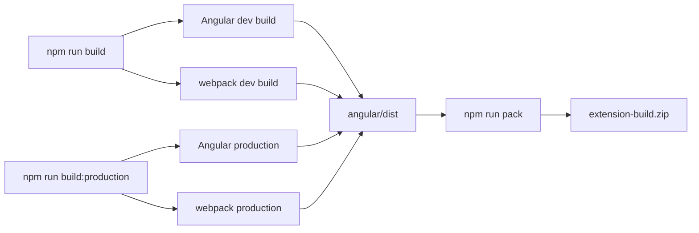

# Contributing

Thanks for stopping by. This is a small, focused extension, so contributions
are straightforward. Please read this before opening a pull request.

> **Maintenance status:** Salesforce is retiring Classic, so this project is in
> maintenance mode. We accept bug fixes and compatibility fixes; large new
> features will usually be declined.

## Prerequisites

- Node.js **18 or newer** (`.nvmrc` pins the version used in CI)
- npm 9 or newer
- Chrome for extension testing

## Setup

```bash
git clone https://github.com/selegic/switch-to-classic.git
cd switch-to-classic
npm ci
```

Plain `npm ci` works; you should not need `--legacy-peer-deps`.

## Building



```bash
# development build -> angular/dist
npm run build

# production build + extension-build.zip
npm run build:production
```

## Loading the extension in Chrome

1. Run `npm run build`.
2. Open `chrome://extensions`.
3. Enable **Developer mode**.
4. Click **Load unpacked** and select the `angular/dist` folder.
5. Open any page on `https://*.lightning.force.com` in a Salesforce org.
   You should see **Switch to Classic Experience** in the Lightning header.
   Click it (or use the toolbar popup) to open the record in Classic.

## Development

```bash
npm run watch          # Angular + webpack watchers
npm run watch:angular  # Angular only
npm run watch:chrome   # webpack only
```

## Project layout

| Path | What it is |
| --- | --- |
| `angular/` | Angular app that renders the extension popup |
| `chrome/` | webpack build for the content script and service worker |
| `angular/src/manifest.json` | extension manifest (source of truth) |
| `tests/` | unit tests for the URL logic |
| `scripts/` | build verification and version sync helpers |
| `docs/` | architecture notes |

See [docs/architecture.md](docs/architecture.md) for how the pieces fit
together.

## Testing

```bash
npm test            # URL-transformation unit tests
npm run verify-build # checks that every file referenced by the manifest exists
```

If you change the Salesforce URL logic, add cases to
`tests/classic-url.test.mjs`.

## Conventions

- Keep the popup dependency-free beyond Angular; the content script and
  service worker are plain TypeScript with `chrome.*` APIs.
- Do not add new host permissions or `chrome.*` permissions without explaining
  why in the pull request — see [PRIVACY.md](PRIVACY.md).
- Match the existing code style (2 spaces, single quotes in TypeScript,
  double quotes in the popup component).
- Run `npm run format` before committing.

## Pull requests

1. Create a branch off `main` (`fix/...`, `feat/...`, `docs/...`).
2. Keep the change small; one concern per PR.
3. Make sure `npm test`, `npm run build`, and `npm run build:production` pass,
   and that `npm run verify-build` is happy with the resulting zip.
4. Describe *what* changed and *why*. Add screenshots for UI changes.
5. CI must be green before review.

## Versioning

Versions are synced from the manifest. Run `npm run sync-version` after
bumping `angular/src/manifest.json`, then commit `package.json` and
`package-lock.json` together.
