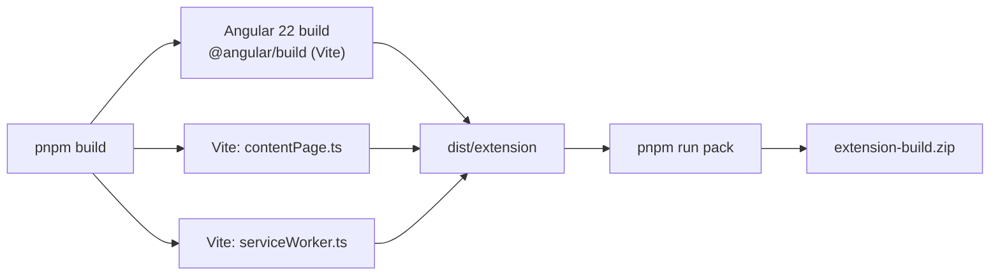

# Contributing

Thanks for stopping by. This is a small, focused extension, so contributions
are straightforward. Please read this before opening a pull request.

> **Maintenance status:** Salesforce is retiring Classic, so this project is in
> maintenance mode. We accept bug fixes and compatibility fixes; large new
> features will usually be declined.

## Prerequisites

- Node.js **24** (`.nvmrc` pins the version used in CI)
- pnpm **12** (see `packageManager` in `package.json`)
- Chrome for extension testing

## Setup

```bash
git clone https://github.com/selegic/switch-to-classic.git
cd switch-to-classic
pnpm install
```

## Building



```bash
# production build -> dist/extension
pnpm build

# production build + extension-build.zip
pnpm build:production
```

## Loading the extension in Chrome

1. Run `pnpm build`.
2. Open `chrome://extensions`.
3. Enable **Developer mode**.
4. Click **Load unpacked** and select the `dist/extension` folder.
5. Open any page on `https://*.lightning.force.com` in a Salesforce org.
   You should see **Switch to Classic Experience** in the Lightning header.
   Click it (or use the toolbar popup) to open the record in Classic.

## Development

```bash
pnpm dev              # Angular + content script + service worker watchers
pnpm dev:app          # Angular only
pnpm dev:content      # content script only
pnpm dev:worker       # service worker only
```

## Project layout

| Path                   | What it is                                                      |
| ---------------------- | --------------------------------------------------------------- |
| `src/`                 | Angular 22 popup and options pages                              |
| `extension/`           | content script and service worker                               |
| `shared/`              | pure URL logic, settings, and message types shared by all parts |
| `public/manifest.json` | extension manifest (source of truth)                            |
| `public/assets/`       | icons copied into the extension                                 |
| `public/content.css`   | styles for the button injected into Salesforce                  |
| `tests/`               | Vitest tests for URL logic and service-worker navigation        |
| `scripts/`             | build verification and version sync helpers                     |
| `docs/`                | architecture and icon notes                                     |

See [docs/architecture.md](docs/architecture.md) for how the pieces fit
together.

## Testing

```bash
pnpm test             # URL and service-worker navigation tests (Vitest)
pnpm check:types      # TypeScript, app + extension
pnpm verify-build     # checks that every file referenced by the manifest exists
```

If you change the Salesforce URL logic, add cases to
`tests/classic-url.test.ts`. If you change navigation, update
`tests/service-worker.test.ts`.

## Conventions

- Keep the popup dependency-free beyond Angular; the content script and
  service worker are plain TypeScript with `chrome.*` APIs.
- Do not add new host permissions or `chrome.*` permissions without explaining
  why in the pull request — see [PRIVACY.md](PRIVACY.md). The extension uses
  `activeTab`, `storage`, and `webNavigation`, plus Salesforce host permissions.
- Run `pnpm check` (Prettier) before committing.
- The content script and service worker are built as IIFEs by Vite; do not
  turn them into ES modules, because Chrome content scripts cannot load them.

## Pull requests

1. Create a branch off `main` (`fix/...`, `feat/...`, `docs/...`).
2. Keep the change small; one concern per PR.
3. Make sure `pnpm test`, `pnpm check:types`, `pnpm build`, and
   `pnpm build:production` pass, and that `pnpm verify-build` is happy with the
   resulting zip.
4. Describe _what_ changed and _why_. Add screenshots for UI changes.
5. CI must be green before review.

## Versioning

Versions are synced from the manifest. Run `pnpm sync-version` after bumping
`public/manifest.json`, then commit `package.json` together.
