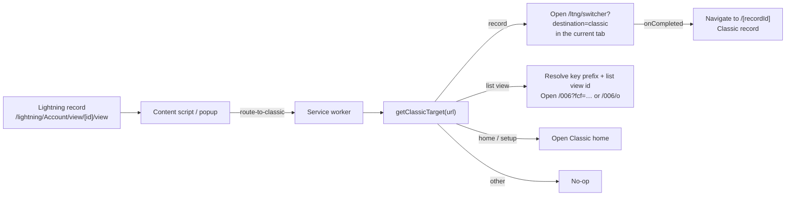

# Switch to Classic

A Chrome extension that adds a **"Switch to Classic Experience"** button to
Salesforce Lightning pages, so administrators and developers can jump from a
Lightning record to Salesforce Classic in one click — instead of navigating
through Setup and menus.

- **One click from Lightning:** the button sits in the Lightning header, next
  to the profile menu, and also lives in the toolbar popup.
- **Opens the same record:** record pages open the matching record in Classic
  (e.g. an Account in Lightning opens the same Account in Classic).
- **Exact list views:** named list views resolve to the same Classic list view;
  “Recently Viewed” opens the Classic object home.
- **Fits your workflow:** switch in the current tab (default) or a new tab,
  hide the header button, and choose a light, dark, or system theme.
- **Private by design:** no data collection, no analytics, no external
  requests. See [PRIVACY.md](PRIVACY.md).

<!-- TODO: add a screenshot (docs/screenshots/usage.gif) here -->
<!--  -->

## Install

### From the Chrome Web Store

1. Open [Selegic Switch to Classic](https://chromewebstore.google.com/detail/selegic-switch-to-classic/ellmmiehdcccalmmdfpoeeablbpnihac)
   in Chrome.
2. Click **Add to Chrome**.

### From source

Requires Node.js 24 and pnpm 12.

```bash
git clone https://github.com/selegic/switch-to-classic.git
cd switch-to-classic
pnpm install
pnpm build
```

Then in Chrome:

1. Go to `chrome://extensions`.
2. Enable **Developer mode**.
3. Click **Load unpacked** and select the `dist/extension` folder.

## Usage

1. Open a record, list view, or tab on `https://*.lightning.force.com` in your
   Salesforce org.
2. **Switch to Classic Experience** appears in the Lightning header. Click it
   (or the toolbar button), and the same record opens in Salesforce Classic in
   the current tab.

What happens per page type:

| Lightning page                                     | Result                                                                                                        |
| -------------------------------------------------- | ------------------------------------------------------------------------------------------------------------- |
| Record page (`/lightning/<Object>/view/<id>/view`) | Opens Classic, then the same record                                                                           |
| List view (`/lightning/o/<Object>/list`)           | Opens the same named Classic list view; “Recently Viewed” opens the object home (e.g. Opportunity → `/006/o`) |
| Home (`/lightning/page/home`) or Setup             | Opens the Classic home                                                                                        |
| Tabs, search, other pages                          | Nothing happens (no Classic equivalent)                                                                       |

## How it works



Under the hood the extension navigates to Salesforce's own
`/ltng/switcher?destination=classic` URL and follows up with the specific
Classic path once the tab has loaded. For list views, the content script asks
the current Salesforce org for the object key prefix and, for named views, the
list-view id; “Recently Viewed” falls back to the object home. The popup,
content script, and service worker communicate over `chrome.runtime` messages.

See [docs/architecture.md](docs/architecture.md) for the full breakdown.

## Settings

Open the toolbar popup and click **Settings**, or use
`chrome://extensions` → **Details** → **Extension options**.

- **Open in a new tab** — off by default; the current tab switches to Classic.
- **Show the switch button** — show or hide the in-page Lightning header button.
- **Appearance** — system, light, or dark.

Settings are stored with `chrome.storage.sync`.

## Permissions

| Permission      | Why                                                                                                     |
| --------------- | ------------------------------------------------------------------------------------------------------- |
| `activeTab`     | Read the current tab URL after you invoke the extension                                                 |
| `storage`       | Save your settings (new tab, header button, theme)                                                      |
| `webNavigation` | Detect when the Classic tab has finished loading so it can navigate to the specific record or list view |

The extension also requests host permissions for `https://*.lightning.force.com/*`,
`https://*.my.salesforce.com/*`, and `https://*.salesforce.com/*` so it can
inject the button and navigate to the Classic domain. The content script only
runs on Lightning pages under those Salesforce hosts.

## Development

Prerequisites: Node.js 24 and pnpm 12 (see `.nvmrc` and `packageManager`).

```bash
pnpm install          # install
pnpm dev              # Angular + Vite watchers
pnpm test             # URL logic tests (Vitest)
pnpm check:types      # TypeScript, app + extension
pnpm check            # Prettier
pnpm build            # production build -> dist/extension
pnpm build:production # production build + extension-build.zip
pnpm verify-build     # check the manifest matches the build output
```

The popup and options page are an Angular 22 standalone app built with the
Angular application builder (Vite). The content script and service worker are
bundled separately with Vite as IIFEs, because Chrome content scripts cannot be
ES modules.

See [CONTRIBUTING.md](CONTRIBUTING.md) for the full workflow.

## Contributing

Contributions are welcome. Please read [CONTRIBUTING.md](CONTRIBUTING.md)
before opening a pull request — the project is in maintenance mode, so bug
fixes and compatibility fixes are the ones we accept.

## License

MIT — see [LICENSE](LICENSE). Trademark rights in "Selegic", "Selegic Switch
to Classic", and in Salesforce marks are **not** granted by the license; see
[TRADEMARKS.md](TRADEMARKS.md).

## Acknowledgements

Built with Angular 22, Vite 8, and the Chrome Extensions APIs. Not affiliated
with or endorsed by Salesforce, Inc.
