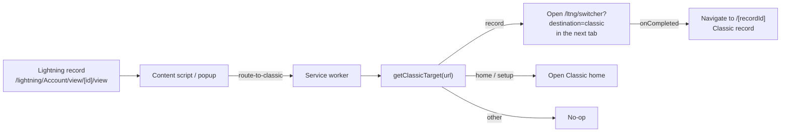

# Switch to Classic

A Chrome extension that adds a **"Switch to Classic Experience"** button to
Salesforce Lightning pages, so administrators and developers can jump from a
Lightning record to Salesforce Classic in one click — instead of navigating
through Setup and menus.

- **One click from Lightning:** the button sits in the Lightning header, next
  to the profile menu, and also lives in the toolbar popup.
- **Opens the same record:** record pages open the matching record in Classic
  (e.g. an Account in Lightning opens the same Account in Classic).
- **Private by design:** no data collection, no analytics, no external
  requests. See [PRIVACY.md](PRIVACY.md).

<!-- TODO: add a screenshot (docs/screenshots/usage.gif) here -->
<!--  -->

## Install

### From the Chrome Web Store

1. Open [Selegic Switch to Classic](https://chromewebstore.google.com/detail/selegic-switch-to-classic/ellmmiehdcccalmmdfpoeeablbpnihac)
   in Chrome.
2. Click **Add to Chrome**.

### From source

```bash
git clone https://github.com/selegic/switch-to-classic.git
cd switch-to-classic
npm ci
npm run build
```

Then in Chrome:

1. Go to `chrome://extensions`.
2. Enable **Developer mode**.
3. Click **Load unpacked** and select the `angular/dist` folder.

## Usage

1. Open a record, list view, or tab on `https://*.lightning.force.com` in your
   Salesforce org.
2. **Switch to Classic Experience** appears in the Lightning header. Click it
   (or the toolbar button), and the same record opens in Salesforce Classic in
   the next tab.

What happens per page type:

| Lightning page | Result |
| --- | --- |
| Record page (`/lightning/<Object>/view/<id>/view`) | Opens Classic, then the same record |
| Home (`/lightning/page/home`) or Setup | Opens the Classic home |
| List views, tabs, search, other pages | Nothing happens (no Classic equivalent) |

## How it works



Under the hood the extension navigates to Salesforce's own
`/ltng/switcher?destination=classic` URL and, for record pages, follows it up
with the Classic record URL once the tab has loaded. The popup, content
script, and service worker communicate over `chrome.runtime` messages.

See [docs/architecture.md](docs/architecture.md) for the full breakdown.

## Permissions

| Permission | Why |
| --- | --- |
| `tabs` | Read the current tab URL to build the Classic URL, and open the Classic page in the next tab |
| `webNavigation` | Detect when the Classic tab has finished loading so it can navigate to the specific record |

The content script only runs on `https://*.lightning.force.com/*`.

## Development

Prerequisites: Node.js 18 or newer, npm, and Chrome.

```bash
npm ci                 # install
npm run watch          # build watchers (Angular + webpack)
npm test               # URL logic tests
npm run build          # development build -> angular/dist
npm run build:production
npm run verify-build   # check the manifest matches the build output
```

See [CONTRIBUTING.md](CONTRIBUTING.md) for the full workflow.

## Contributing

Contributions are welcome. Please read [CONTRIBUTING.md](CONTRIBUTING.md)
before opening a pull request — the project is in maintenance mode, so bug
fixes and compatibility fixes are the ones we accept.

## License

MIT — see [LICENSE](LICENSE). Trademark rights in "Selegic", "Selegic Switch
to Classic", and in Salesforce marks are **not** granted by the license; see
[TRADEMARKS.md](TRADEMARKS.md).

## Acknowledgements

Built with Angular, webpack, and the Chrome Extensions APIs. Not affiliated
with or endorsed by Salesforce, Inc.
