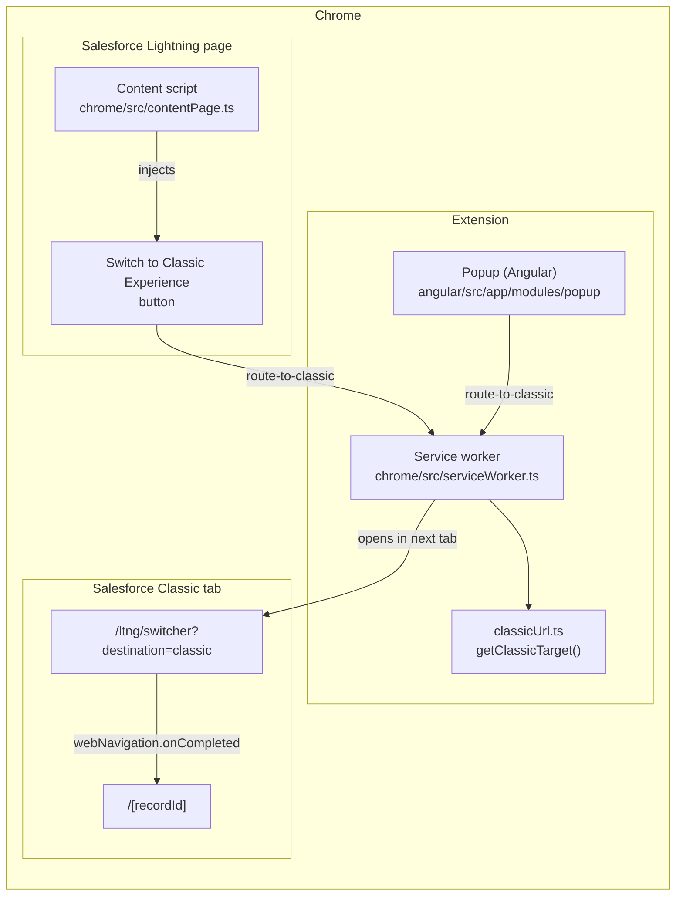
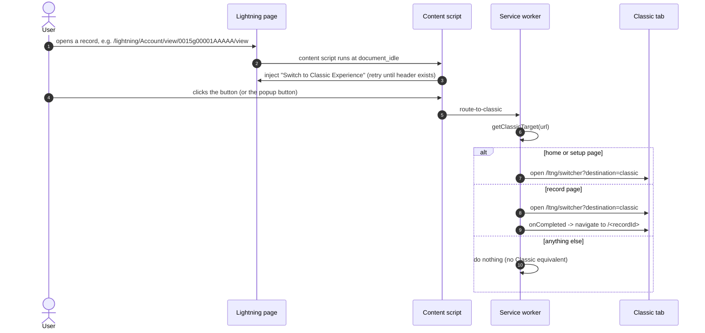
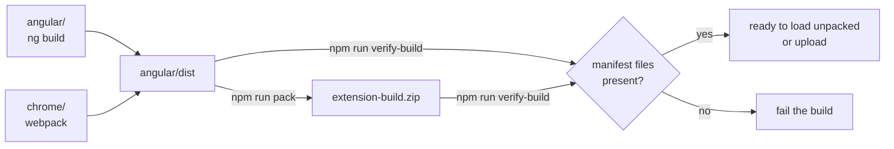

# Architecture

`switch-to-classic` is a Manifest V3 Chrome extension with three cooperating
parts and one shared build output directory (`angular/dist`).

The content script and the popup both send `route-to-classic` to the same
service worker, which owns all URL translation and tab handling.

## Components

### Content script — `chrome/src/contentPage.ts`

Injected by Chrome into `https://*.lightning.force.com/*` pages, using
`styles.css` (which is why the production build must keep that filename
stable). It:

1. Waits for the Lightning global header (`#oneHeader ... ul`), retrying
   briefly if the header has not rendered yet.
2. Injects a `Switch to Classic Experience` item into that header.
3. On click, sends `route-to-classic` to the service worker.

The styling for the injected button lives in `angular/src/styles.scss`, so it
ships in the Angular bundle as `styles.css`.

### Service worker — `chrome/src/serviceWorker.ts`

A Manifest V3 background service worker. It listens for runtime messages:

| Message | Behaviour |
| --- | --- |
| `route-to-classic` | Reads the active tab URL, computes the Classic target, opens it in the tab right after the current one; for record pages it navigates to the record once Classic has loaded |

The URL translation itself is a pure function
(`chrome/src/classicUrl.ts`, `getClassicTarget`) so it can be unit tested
without Chrome APIs — see `tests/`.

### Popup — `angular/src/app/modules/popup/...`

An Angular 13 app whose only route is `#/popup`, shown when the user clicks
the toolbar button (`action.default_popup`). It renders a single
**Switch to Salesforce Classic** button that sends `route-to-classic` to the
service worker.

The application bootstraps through `main.ts`, which queries the active tab and
provides its id via the `TAB_ID` injection token
(`angular/src/app/providers/tab-id.provider.ts`).

### Manifest — `angular/src/manifest.json`

Source of truth for the extension. It references built files by stable name,
which is why the Angular production build uses `outputHashing: "none"`
instead of `"all"`.

## How the switch works

1. The user is on a Lightning record page, e.g.
   `/lightning/Account/view/0015g00001AAAAA/view`.
2. The service worker extracts the record id (`0015g00001AAAAA`) and opens
   `/ltng/switcher?destination=classic&referrer=%2Flightning%2Fpage%2Fhome`
   in the next tab — Salesforce's own URL for leaving Lightning for Classic.
3. Using `chrome.webNavigation.onCompleted`, it waits for that tab, then
   navigates to `/<recordId>`, the Classic record view.

Lightning home (`/lightning/page/home`) and Setup (`/lightning/setup/SetupOneHome/home`)
just open the switcher URL. Anything else (list views, tabs, search, ...)
currently has no Classic equivalent and the extension does nothing.

## Build pipeline

- `npm run build` — development build (Angular dev + webpack dev).
- `npm run build:production` — Angular production + webpack production + zip.
- `npm run verify-build` — checks that every file referenced by
  `manifest.json` exists in `angular/dist` (and in the zip, when present).
- `npm run sync-version` — keeps the version identical in
  `angular/src/manifest.json`, `package.json` and `package-lock.json`.

Notable detail: `webpack` and `webpack-merge` were previously only present
because Angular hoisted them; they are now declared dependencies of the root
project. The production webpack config must bundle **both** `contentPage` and
`serviceWorker`; historically it only bundled the former, so the shipped zip
had no service worker.

## Dependencies worth knowing about

- **ngx-build-plus** — enables the Angular webpack pipeline and the
  `~angular/sourcemaps-plugin.js` hook used in watch mode.
- **Angular 13** (end of life since 2023). A future migration is the single
  biggest maintainability item; the popup is one button, so dropping Angular
  entirely is also an option.

## Testing

`npm test` runs the URL logic tests with the Node test runner. No browser or
test framework is required; the tests transpile `chrome/src/classicUrl.ts`
with the project's TypeScript dependency and import it from a data URL, so they
work on Node 18+.
