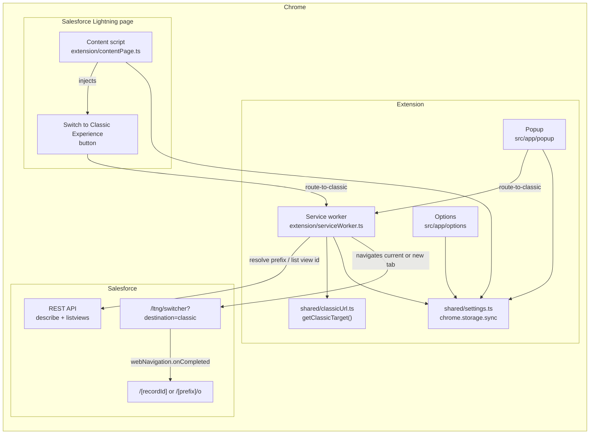
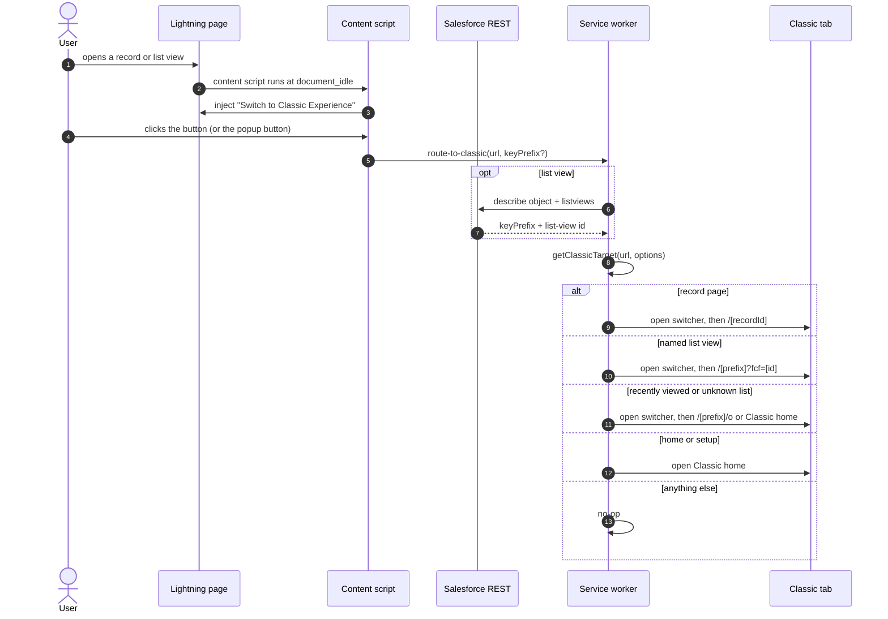
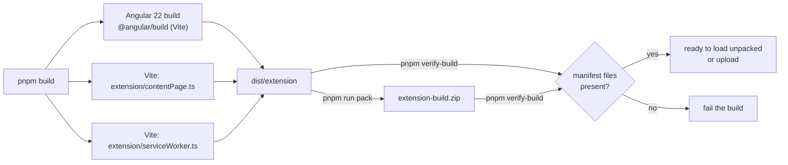

# Architecture

`switch-to-classic` is a Manifest V3 Chrome extension with three cooperating
parts, shared pure modules, and one build output directory (`dist/extension`).

The content script and popup send `route-to-classic` to the service worker,
which owns URL translation and tab handling. `shared/` holds the pure URL
logic, settings, and message types used by every part.

## Components

### Content script — `extension/contentPage.ts`

Injected by Chrome into Lightning pages under the Salesforce hosts, using
`content.css` for the injected button. It:

1. Reads the `showHeaderButton` setting and waits for the Lightning header,
   retrying briefly and re-injecting after SPA re-renders.
2. Sends `route-to-classic` with the page URL and, when available, a key
   prefix read from a record link on the page.
3. Shows a short busy state while the service worker resolves the target.

The styling for the injected button lives in `public/content.css`, which is
copied into the extension root. The content script is bundled by Vite as an
IIFE (`vite.content.config.ts`) because Chrome content scripts cannot be ES
modules.

### Service worker — `extension/serviceWorker.ts`

A Manifest V3 background service worker. It listens for one message:

| Message            | Behaviour                                                                                                                                                                                        |
| ------------------ | ------------------------------------------------------------------------------------------------------------------------------------------------------------------------------------------------ |
| `route-to-classic` | Computes the Classic target, then navigates the current tab or opens a new tab depending on settings; for records and list views it follows up with the specific Classic path once Classic loads |

The URL translation is a pure function in `shared/classicUrl.ts`
(`getClassicTarget`) so it can be unit tested without Chrome APIs — see
`tests/classic-url.test.ts` and `tests/service-worker.test.ts`.

For list views, the service worker calls the current org's REST API:

- `GET /services/data/` to find the latest API version.
- `GET /services/data/vXX.X/sobjects/{Object}/describe` for `keyPrefix`.
- `GET /services/data/vXX.X/sobjects/{Object}/listviews` for the
  `developerName → id` mapping used by Classic's `fcf` parameter.

It tries the Classic host (`*.my.salesforce.com`) first, then the page origin,
and falls back to the content-script key prefix or the static map.

The service worker is bundled by Vite as an IIFE (`vite.worker.config.ts`) so
it needs no module support from Chrome.

### Popup — `src/app/popup`

An Angular 22 standalone popup shown by `action.default_popup`. It classifies
the active tab (`Record page`, `List view`, `Lightning home`,
`Salesforce Classic`, or unsupported), explains what will happen, and disables
the button when there is nothing to switch.

It links to the options page and shows the current status without sending the
user anywhere until they click the primary button.

### Options — `src/app/options`

An Angular route at `#/options`, opened by `options_ui` or the popup's
Settings link. It stores settings with `chrome.storage.sync`:

- `openInNewTab` (default `false`)
- `showHeaderButton` (default `true`)
- `theme` (`system`, `light`, or `dark`)

### Manifest — `public/manifest.json`

Source of truth for the extension. Angular copies everything in `public/` into
`dist/extension`, including the manifest, `content.css`, and icons. It
references built files by stable name, which is why the production build uses
`outputHashing: "none"`.

Permissions:

- `activeTab` — read the current tab URL after the user invokes the extension.
- `storage` — persist settings.
- `webNavigation` — follow up after the switcher loads.
- Host permissions for the Salesforce Lightning, `my.salesforce.com`, and
  `salesforce.com` domains.

## How the switch works

For records, the Classic record URL is `/<recordId>`. For list views, Classic
needs a key prefix (`/006/o`) and, for named views, a list-view id
(`/006?fcf=00B...`). `__Recent` is a special Salesforce list view and falls
back to the object home. The service worker navigates the current tab by
default, or opens a new tab when the setting is enabled.

## Build pipeline

- `pnpm build` — production Angular build + Vite extension builds.
- `pnpm build:production` — the same, plus `extension-build.zip`.
- `pnpm verify-build` — checks that every file referenced by
  `manifest.json` exists in `dist/extension` (and in the zip, when present).
- `pnpm sync-version` — keeps the version identical in
  `public/manifest.json` and `package.json`.

Angular's application builder writes `index.html`, `main.js`, `polyfills.js`
(if any), `styles.css`, and `3rdpartylicenses.txt` into `dist/extension`. The
two Vite builds then add `contentPage.js` and `serviceWorker.js` to the same
directory with `emptyOutDir: false`.

## Dependencies worth knowing about

- **Angular 22** — standalone components, zoneless change detection, the
  `@angular/build:application` builder, and Vite under the hood.
- **Vite 8** — bundles the content script and service worker as IIFEs.
- **Vitest 5** — URL logic and service-worker navigation tests.

## Testing

`pnpm test` runs Vitest. `tests/classic-url.test.ts` covers URL translation,
including list-view ids and Classic detection. `tests/service-worker.test.ts`
mocks `chrome.*` and covers same-tab, new-tab, and follow-up navigation.
