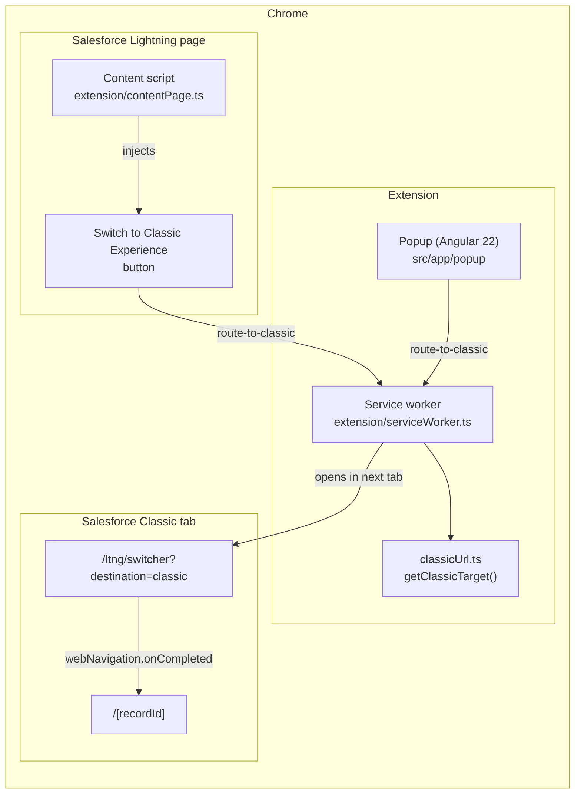
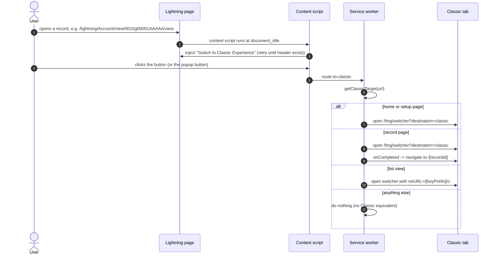
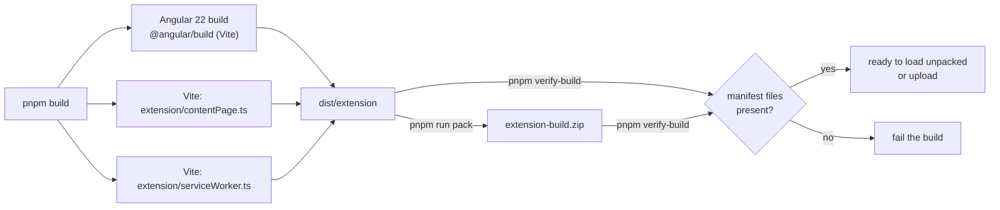

# Architecture

`switch-to-classic` is a Manifest V3 Chrome extension with three cooperating
parts and one shared build output directory (`dist/extension`).

The content script and the popup both send `route-to-classic` to the same
service worker, which owns all URL translation and tab handling.

## Components

### Content script — `extension/contentPage.ts`

Injected by Chrome into `https://*.lightning.force.com/*` pages, using
`styles.css` (which is why the production build must keep that filename
stable). It:

1. Waits for the Lightning global header (`#oneHeader ... ul`), retrying
   briefly if the header has not rendered yet.
2. Injects a `Switch to Classic Experience` item into that header.
3. On click, sends `route-to-classic` to the service worker.

The styling for the injected button lives in `src/styles.scss`, so it ships in
the Angular bundle as `styles.css`.

The content script is bundled by Vite as an IIFE (`vite.content.config.ts`)
because Chrome content scripts cannot be ES modules.

### Service worker — `extension/serviceWorker.ts`

A Manifest V3 background service worker. It listens for runtime messages:

| Message            | Behaviour                                                                                                                                                                   |
| ------------------ | --------------------------------------------------------------------------------------------------------------------------------------------------------------------------- |
| `route-to-classic` | Reads the active tab URL, computes the Classic target, opens it in the tab right after the current one; for record pages it navigates to the record once Classic has loaded |

The URL translation itself is a pure function
(`extension/classicUrl.ts`, `getClassicTarget`) so it can be unit tested
without Chrome APIs — see `tests/`.

The service worker is bundled by Vite as an IIFE (`vite.worker.config.ts`) so
it needs no module support from Chrome.

### Popup — `src/app/popup`

An Angular 22 standalone app whose only route is `#/popup`, shown when the
user clicks the toolbar button (`action.default_popup`). It renders a single
**Switch to Salesforce Classic** button that sends `route-to-classic` to the
service worker.

`src/main.ts` bootstraps `App` with `appConfig`, which provides the router
using `withHashLocation()`. The popup route is lazy-loaded with
`loadComponent`.

### Manifest — `public/manifest.json`

Source of truth for the extension. Angular copies everything in `public/` into
`dist/extension`, including the manifest and icons. It references built files
by stable name, which is why the production build uses
`outputHashing: "none"`.

## How the switch works

1. The user is on a Lightning record page, e.g.
   `/lightning/Account/view/0015g00001AAAAA/view`.
2. The service worker extracts the record id (`0015g00001AAAAA`) and opens
   `/ltng/switcher?destination=classic&referrer=%2Flightning%2Fpage%2Fhome`
   in the next tab — Salesforce's own URL for leaving Lightning for Classic.
3. Using `chrome.webNavigation.onCompleted`, it waits for that tab, then
   navigates to `/<recordId>`, the Classic record view.

Lightning home (`/lightning/page/home`) and Setup (`/lightning/setup/SetupOneHome/home`)
just open the switcher URL. List views (`/lightning/o/<Object>/list`) open the
Classic object home through the switcher's `retURL` parameter, using a key
prefix supplied by the content script or the standard-object map in
`extension/classicUrl.ts`. Tabs, search, and other pages currently have no
Classic equivalent and the extension does nothing.

## Build pipeline

- `pnpm build` — production Angular build + Vite extension builds.
- `pnpm build:production` — the same, plus `extension-build.zip`.
- `pnpm verify-build` — checks that every file referenced by
  `manifest.json` exists in `dist/extension` (and in the zip, when present).
- `pnpm sync-version` — keeps the version identical in
  `public/manifest.json` and `package.json`.

Angular's application builder writes `index.html`, `main.js`, `polyfills.js`,
`styles.css`, and `3rdpartylicenses.txt` into `dist/extension`. The two Vite
builds then add `contentPage.js` and `serviceWorker.js` to the same directory
with `emptyOutDir: false`.

## Dependencies worth knowing about

- **Angular 22** — standalone components, the `@angular/build:application`
  builder, and Vite under the hood. The popup is small enough that dropping
  Angular for plain TypeScript remains an option if the framework ever becomes
  a burden.
- **Vite 8** — bundles the content script and service worker as IIFEs.
- **Vitest 5** — runs the URL logic tests.

## Testing

`pnpm test` runs the URL logic tests with Vitest. The tests import
`extension/classicUrl.ts` directly, so no browser or Chrome APIs are needed.
